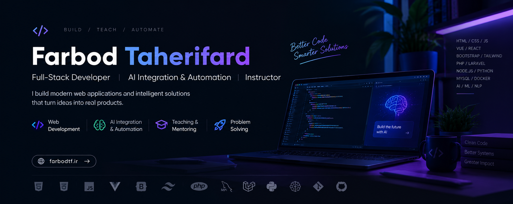

  

<h1 align="center">Farbod Taherifard 👋</h1>

<h3 align="center">Full-Stack Developer | AI Integration & Automation | Instructor</h3>

  Building modern web applications and intelligent software solutions.

  <a href="https://farbodtf.ir">Portfolio</a> ·
  <a href="https://github.com/farbodtf">GitHub</a> ·
  <a href="https://www.linkedin.com/in/farbod-taherifard-21b480204/">LinkedIn</a> ·
  <a href="mailto:farbod.taherifard@gmail.com">Email</a>

---

## 👨‍💻 About Me

I'm a Full-Stack Web Developer and Instructor passionate about building scalable web applications, reliable backend systems, and practical software solutions.

I combine software engineering with AI-powered capabilities to create smarter applications and automate real-world workflows.

- 💻 Developing modern, responsive web applications.
- ⚙️ Building backend systems, APIs, and database-driven solutions.
- 🤖 Integrating LLMs and AI features into web applications.
- 🔄 Creating intelligent automation tools.
- 🎓 Teaching web development and sharing knowledge.

## 🛠️ Tech Stack

### Frontend

  

### Backend

  

### AI & Data

  

### Tools

  

## 🚀 What I Do

- **Full-Stack Development:** Responsive interfaces, backend APIs, and database-driven applications.
- **AI Integration:** Bringing language models and intelligent features into web products.
- **Automation:** Building tools that simplify repetitive tasks and workflows.
- **Teaching:** Explaining complex concepts through practical examples.

## 🧠 AI Meets Web Development

My work focuses on integrating AI into real-world software:

- LLM-powered applications and API integrations.
- Natural-language interfaces and AI-assisted features.
- Machine learning and NLP applications.
- Intelligent workflow automation.

## 📌 Projects & Portfolio

Explore my work and projects:

  
  

## 📊 GitHub Statistics

  

  

## 🎓 Teaching & Knowledge Sharing

I enjoy turning complex technical concepts into clear, practical lessons and helping developers build real-world skills.

## 🤝 Let's Connect

- 🌐 Website: [farbodtf.ir](https://farbodtf.ir)
- 💻 GitHub: [@farbodtf](https://github.com/farbodtf)
- 💼 LinkedIn: [Connect with me](https://www.linkedin.com/in/farbod-taherifard-21b480204/)
- 📫 Email: [farbod.taherifard@gmail.com](mailto:farbod.taherifard@gmail.com)

---

  <i>"Great software solves problems. Great ideas make it matter."</i>

  ⭐ Thanks for visiting my profile!

